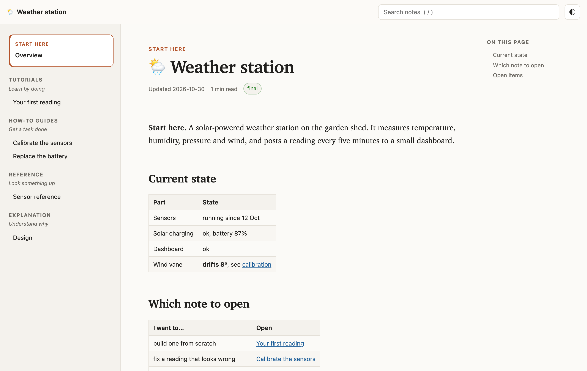
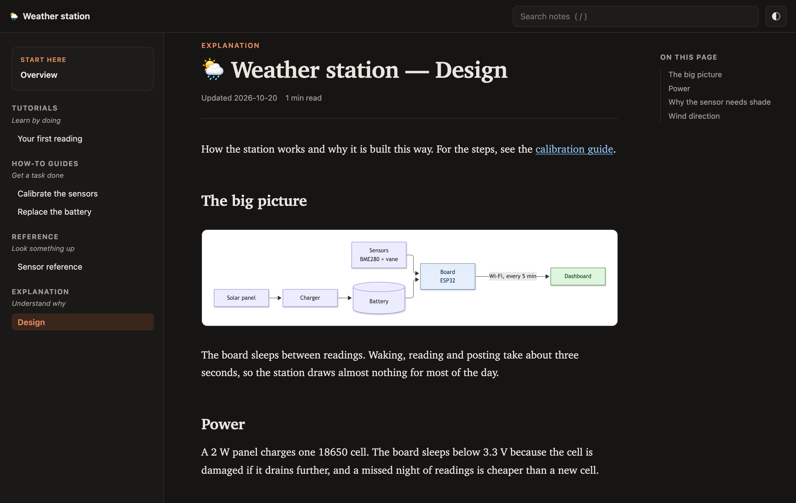
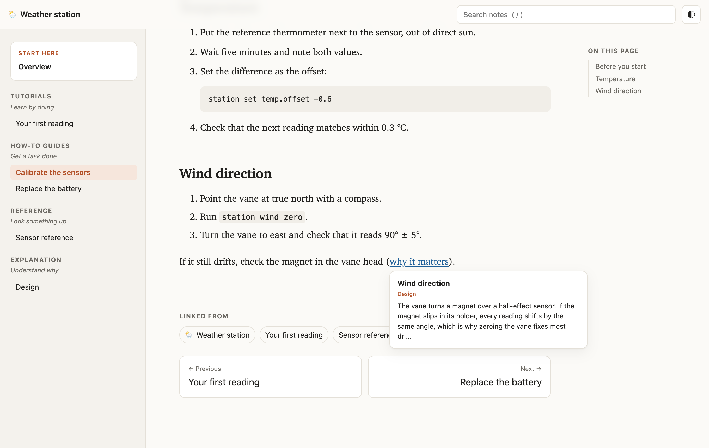
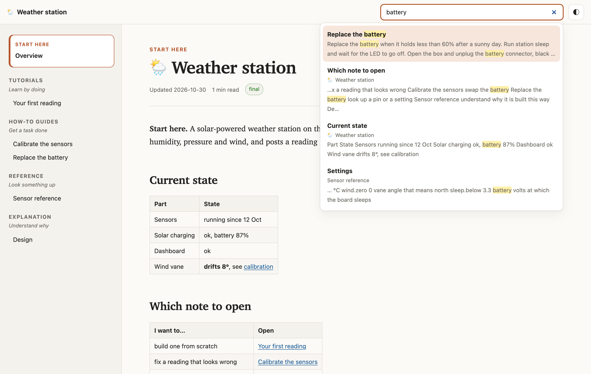
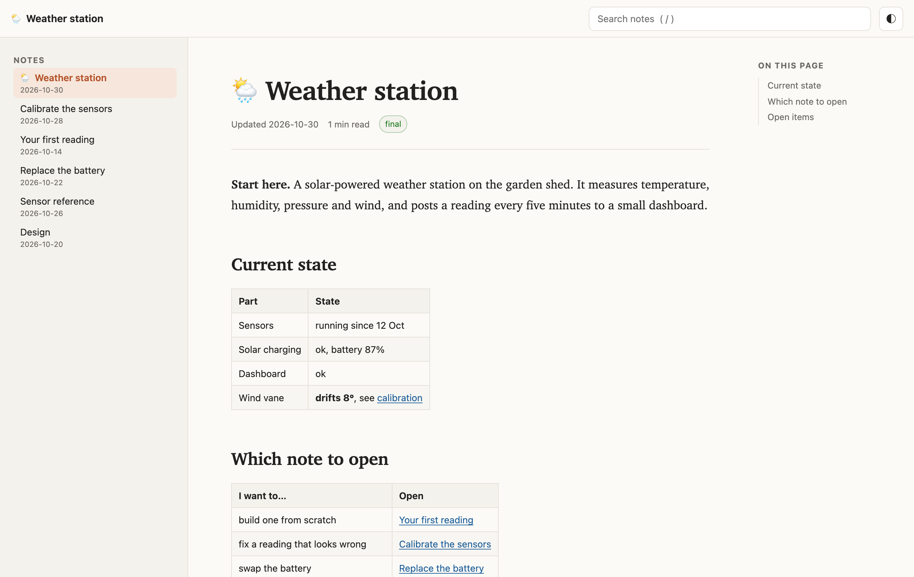
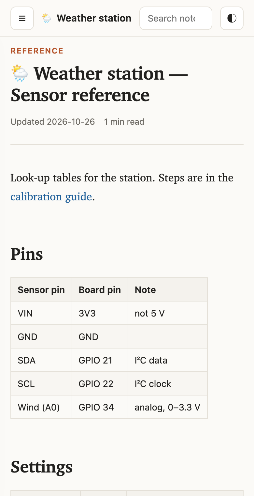
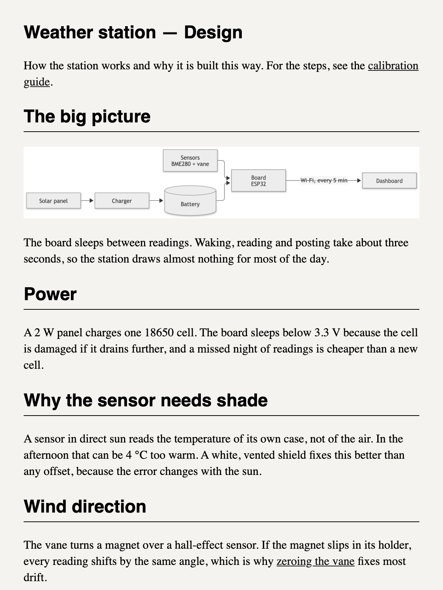
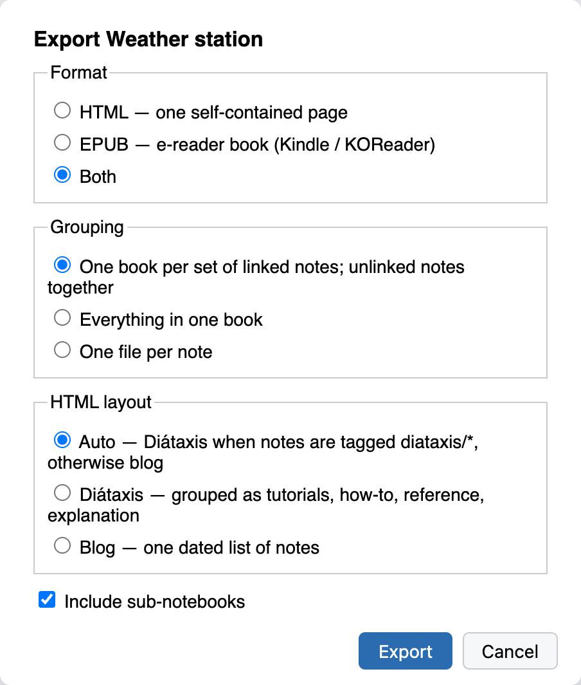

# Book Export for Joplin

Export a notebook, or a set of notes that link to each other, as **one** self-contained
HTML page or **one** EPUB book for an e-reader (Kindle with KOReader, Kobo, phone readers).



*All screenshots show a made-up "Weather station" notebook of six linked notes.*

## What it does

- **Linked notes become one book.** Notes that link to each other (in either direction,
  directly or through a chain) are exported together. The note with the most links is the
  first chapter, and the rest follow the order its links appear in.
- **Unlinked notes are kept together**, as one "Unlinked notes" book per notebook.
- **Links keep working.** A link to another note in the book, including a link to a
  heading inside it (`[x](:/id#anchor)`, the Note Link System `{#anchor}` syntax), jumps to
  the right place in the export.
- **Mermaid diagrams are rendered**: inline SVG in HTML, PNG in EPUB (e-ink readers cannot
  draw HTML-labelled SVG). Rendering happens locally, inside Joplin.
- **Images (attachments) are embedded**, so the files work offline and can be shared.
- **HTML reads like a blog**: one note at a time in a readable column, with a sidebar of
  notes, an *On this page* outline, search, link previews on hover, click-to-zoom diagrams,
  *Linked from* backlinks, previous / next links, reading time, and light and dark themes.
  Each note's own *Contents* section is hidden, since the reader builds its own.
- **EPUB is tuned for e-ink**: linear, with a nested table of contents per note and heading,
  emoji turned into text labels, and plain serif styling that follows the reader's font
  settings.

## What you get

**Diagrams and dark mode.** Mermaid diagrams are drawn into the page, so the file needs no
internet connection. The theme follows your system, or the toggle at the top right.



**Links between notes.** Hover a link to preview the section it points to. Each note
ends with the notes that link to it and previous / next links.



**Search.** Type in the search box (or press `/`) to search every heading and paragraph in
the book.



**Blog layout.** Notebooks without Diátaxis tags get one list of notes with their dates.



<table>
<tr>
<td width="50%"><strong>On a phone</strong>, the sidebar folds behind a menu button.<br><br></td>
<td width="50%"><strong>EPUB</strong> keeps the text plain, so the e-reader's own font and size apply. Diagrams become images. (Shown here in a browser, in greyscale.)<br><br></td>
</tr>
</table>

## How to use

- Right-click a notebook → **Export notebook as book (HTML / EPUB)…**
- Select notes, right-click → **Export selected notes as book (HTML / EPUB)…**
- Or **Tools → Export notebook as book…** for the current notebook.



Choose the format (HTML, EPUB or both) and how to group notes:

| Grouping | Result |
|---|---|
| Linked sets (default) | One file per set of linked notes, plus one for unlinked notes |
| Everything in one book | One file for the whole selection |
| One file per note | One file per note |

For HTML, also choose the layout of the sidebar:

| HTML layout | Result |
|---|---|
| Auto (default) | Diátaxis if any note in the book has a `diataxis/*` tag, otherwise Blog |
| Diátaxis | Notes grouped by what the reader needs (see below) |
| Blog | One list of notes, each with its last-updated date |

Books are saved to the folder set in **Settings → Book Export** (you are asked the first
time). Links to notes outside the export open the note in Joplin (HTML) or show its title
(EPUB).

## Diátaxis layout

[Diátaxis](https://diataxis.fr) is a framework for technical documentation. It sorts
writing by what the reader needs at that moment. The Diátaxis layout groups the sidebar
the same way:

| Group | Reader needs to… | Tag |
|---|---|---|
| Tutorials | learn by doing | `diataxis/tutorial` |
| How-to guides | get a task done | `diataxis/how-to` |
| Reference | look something up | `diataxis/reference` |
| Explanation | understand why | `diataxis/explanation` |

A note's type comes from its tag first. Without a tag, words in the title decide: *runbook*,
*checklist* or *test plan* mean how-to, *glossary* or *schema* mean reference, and *design*
or *architecture* mean explanation (the full list is in `src/core/diataxis.ts`). Notes that
match nothing go under *Other notes*. In a linked set, the hub note (the one with the most
links) is pinned at the top as **Start here**.

Diátaxis works best when each note is written as exactly one type. The layout only groups
notes; it does not split a note that mixes them. For more on writing in each type, see
[diataxis.fr](https://diataxis.fr).

## Development

```bash
npm install
npm test        # unit tests (vitest) for the core in src/core
npm run dist    # builds publish/<id>.jpl
```

`src/core` holds the export logic with no Joplin dependency (grouping, link rewriting,
rendering, Diátaxis classification, HTML and EPUB assembly) and is fully unit-tested.
`src/core/html` holds the reader's stylesheet and script. `src/*.ts` is the Joplin glue,
and `src/webview` is the diagram renderer that runs in the progress dialog.

See [GENERATOR_DOC.md](./GENERATOR_DOC.md) for building and publishing.

### Releasing

```bash
npm run updateVersion          # bumps the patch version in package.json and src/manifest.json
git commit -am "chore: release v$(node -p 'require("./package.json").version')"
git tag -a "v$(node -p 'require("./package.json").version')" -m release
git push --follow-tags   # pushes annotated tags only, hence tag -a
```

The tag starts [the publish workflow](.github/workflows/publish.yml). It checks that the tag
matches both version numbers, runs the tests, publishes to npm with provenance (npm
trusted publishing, so no token is stored), and attaches the `.jpl` to a GitHub release.
Joplin lists the new version within about an hour.

## Licence

MIT. Bundles [mermaid](https://github.com/mermaid-js/mermaid) (MIT).
